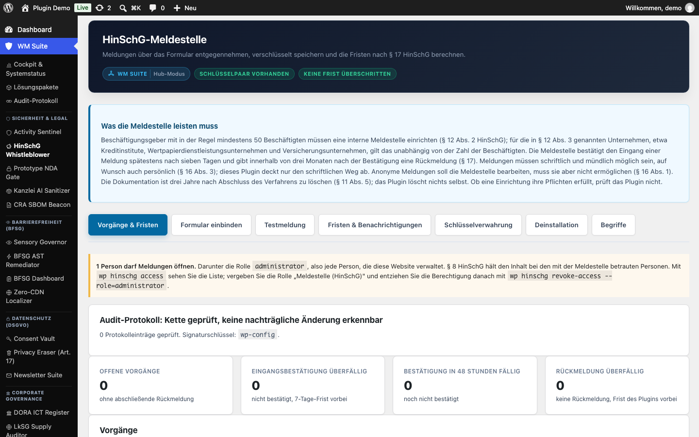
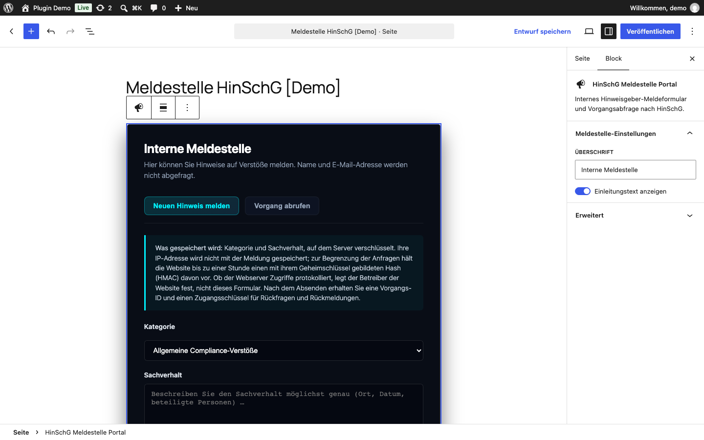
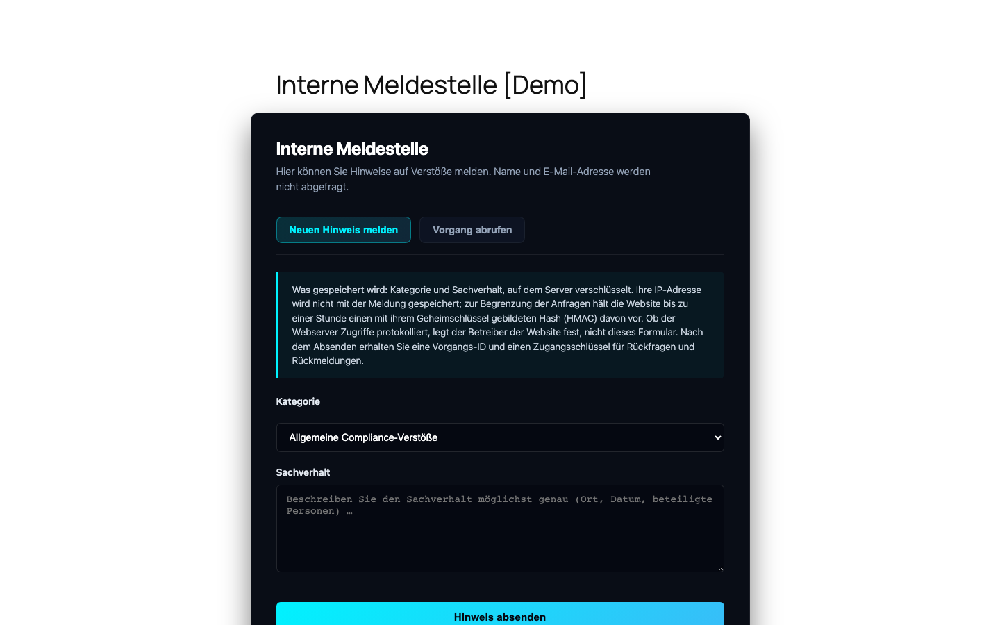

# WM HinSchG Whistleblower Desk (Deutsche Dokumentation)

<p align="center">
  <a href="README.md"></a>
  <a href="README.de.md"></a>
  <a href="README.es.md"></a>
</p>

WordPress-Plugin für einen internen Meldekanal nach dem Hinweisgeberschutzgesetz (HinSchG): Meldeformular, serverseitige Verschlüsselung von Hinweisen und Rückfragen, die Fristen nach § 17 HinSchG sowie ein verkettetes Audit-Protokoll.

Erfordert WordPress 6.4 und PHP 8.2. Version 1.4.1 (Plugin-Header). **Plugin-Seite:** [https://arnoldwender.com/wordpress-plugins/wm-hinschg-whistleblower/](https://arnoldwender.com/wordpress-plugins/wm-hinschg-whistleblower/)

Frühere Marketing-Banner und frühe UI-Mockups wurden am 2026-11-20 außerhalb des Repositorys archiviert (Release 1.4.0).

> **Plugin-Seite:** [https://arnoldwender.com/wordpress-plugins/wm-hinschg-whistleblower/](https://arnoldwender.com/wordpress-plugins/wm-hinschg-whistleblower/)  
> **Mit einem agentischen Workflow entwickelt:** entstanden mit KI-Coding-Agenten. Prüfen und testen Sie es wie jeden fremden Code, bevor Sie es produktiv einsetzen.  
> **Support & Haftung:** Kein Support (Zero Support) — reproduzierbare Bugs ausschließlich über [GitHub Issues](https://github.com/arnoldwender/wm-wp-hinschg-whistleblower/issues) · kein privater Support · OHNE GEWÄHR („AS IS“) / keine Haftung ([SUPPORT.md](SUPPORT.md))

## Live-Vorschau

!WM HinSchG Whistleblower Desk Banner

| Fall-Cockpit | Gutenberg-Editor | Öffentliches Meldeformular |
|---|---|---|
|  |  |  |

## Was das Plugin leistet

- **Meldeformular & Gutenberg-Block:** `[wm_whistleblower_portal]` (gleichwertig: `[wm_hinschg_portal]`) sowie der Gutenberg-Block `wm/hinschg-portal` (`blocks/portal/block.json`, Editor-Skript `wm-hinschg-blocks-editor` mit `InspectorControls` und `ServerSideRender`) stellen ein Melde- und Statusformular mit Kategorie und Beschreibung bereit.
- **Block Bindings & GenerateBlocks 2.x:** Registriert die WordPress-6.5+-Block-Bindings-Quelle `wm-hinschg/status` und das GenerateBlocks-2.x-Dynamic-Tag `{{wm_hinschg_status}}` für nicht-vertrauliche Kanalangaben (`channel_label`, `ack_days`, `feedback_months`).
- **Fall-ID und Zugriffstoken:** Nach dem Absenden erhält die hinweisgebende Person eine Fall-ID und ein 64-stelliges Zugriffstoken (einmalig angezeigt). Die Datenbank speichert ausschließlich einen HMAC-SHA256-Hash des Tokens mit dem WordPress-Auth-Salt.
- **Verschlüsselung im Ruhezustand:** Hinweise und Nachrichten werden serverseitig mit AES-256-GCM unter einem Einmalschlüssel verschlüsselt, der mit einem bei Aktivierung erzeugten RSA-4096-Public-Key versiegelt wird (im Modus `offline-custody` clientseitig im Browser via WebCrypto).
- **Fristen:** Eingangsbestätigung = Eingang + 7 Tage; Rückmeldung = Eingang + 3 Monate (§ 17 Abs. 2 HinSchG rechnet drei Monate ab Bestätigung bzw. drei Monate und sieben Tage ab Eingang).
- **Cockpit im wp-admin** (Menü „Meldestelle (HinSchG)“): letzte 50 Fälle mit Status und Fristen, Zähler für überfällige und anstehende Fristen, Einbettungshinweise, Testmeldung, Fristenregeln, Glossar sowie Dashboard-Widget. Ohne echte Fälle stehen drei Demo-Fälle (`token_demo_1` bis `token_demo_3`) zur Verfügung.
- **Fristenprüfung & Hooks:** Stündlicher WP-Cron zählt verstrichene Fristen und löst `wm_hinschg_sla_breach_detected` aus; beim Start feuert `wm_hinschg_ready`. Ratenlimits und Portal-Konfiguration lassen sich über `wm_hinschg_rest_rate_limit` und `wm_hinschg_portal_config` filtern. Das Plugin versendet selbst keine E-Mails.
- **Fallbearbeitung:** Die Detailansicht entschlüsselt Meldung und Nachrichtenverlauf (oder führt die Entschlüsselung im Modus `offline-custody` lokal im Browser aus), enthält das Panel **Fallbearbeitung nach § 17 HinSchG** für Eingangsbestätigung (`POST /wm-hinschg/v1/admin/ack`) und Rückmeldung (`POST /wm-hinschg/v1/admin/reply`); `GET /wm-hinschg/v1/admin/case` liefert dasselbe bei Berechtigung `wm_hinschg_read_cases`. Jeder Zugriff schreibt `CASE_OPENED_BY_COMPLIANCE_OFFICER` in die Audit-Kette. Rückmeldungen der Meldestelle hängen eine symmetrische `reporter_box` (`sodium_crypto_secretbox`) an, während Meldungen der hinweisgebenden Person asymmetrisch RSA-OAEP-verschlüsselt bleiben.
- **Zweit-Wiederherstellungsschlüssel & Multisite:** Der Tab *Schlüsselverwahrung* unterstützt einen optionalen zweiten RSA-Public-Key (`wm_hinschg_recovery_public_key`) für eine Stellvertretung oder Ombudsperson (§ 8 Abs. 1, § 15 HinSchG); `wp_initialize_site` initialisiert Tabellen, Rollen, Cron und Schlüssel auf neuen Multisite-Websites bei Netzwerkaktivierung.
- **Zugriffsrechte:** Das Plugin deklariert die Capability `wm_hinschg_read_cases` und die Rolle `Meldestelle (HinSchG)`. Bei Installation und Update erhält zunächst die Administrator-Rolle die Berechtigung; `wp hinschg access`, `wp hinschg grant-access` und `wp hinschg revoke-access` verwalten sie per CLI (Entzug der letzten Berechtigung wird verweigert).
- **Schlüsselablage ohne Klartext-PEM auf Neuinstallationen:** `WM_HINSCHG_PRIVATE_KEY` in `wp-config.php` hält den Schlüssel außerhalb der Datenbank; `WM_HINSCHG_MASTER_KEY` versiegelt den privaten RSA-4096-Schlüssel in `wp_options` per `sodium_crypto_secretbox` und migriert Alt-Keys transparent; `WM_HINSCHG_KEY_PASSPHRASE` nutzt OpenSSL-Passphrase-Verschlüsselung. Neuaktivierungen schreiben niemals einen unverschlüsselten PEM-Privatschlüssel in `wp_options`.
- **Audit-Protokoll:** Einreichungen, Nachrichten, Eingangsbestätigung, Rückmeldung, Fallöffnungen und Testmeldungen werden mit HMAC über den Vorgänger verkettet (`wp hinschg audit` prüft die Kette). Manipulationsnachweis statt unveränderlicher Hardware-Speicherung.
- **REST-API** unter `wm-hinschg/v1`: `report/submit`, `report/status`, `report/chat` (anonymes Portal ohne IP-Speicherung, stündlich rotierender HMAC-Rate-Limiter), `admin/cases`, `admin/case`, `admin/ack`, `admin/reply` (`wm_hinschg_read_cases`).
- **WP-CLI:** `wp hinschg list`, `wp hinschg sla-check`, `wp hinschg audit`, `wp hinschg key-status`, `wp hinschg protect-key`, `wp hinschg access`, `wp hinschg grant-access`, `wp hinschg revoke-access`.
- **Übersetzungen:** `.pot`, `.po`/`.mo` sowie Block-Editor-JED-`.json`-Kataloge in 28 Sprachpaketen.
- **WM Suite Hub:** Modulstatus (`NEEDS_CONFIG`, `ERROR`, `DEGRADED`, `HEALTHY`), Telemetrie und Aktionen `self_test`, `audit_chain`, `sla_check`.
- **Deinstallation:** Bereinigt Ratenlimit-/Test-Transients und Cron, bewahrt aber standardmäßig die gesetzlichen Aufbewahrungsdaten nach § 11 HinSchG (`wm_whistle_reports`, `wm_whistle_messages`, `wm_whistle_audit_log`), Schlüssel, Kettenspitze und Rolle, sofern `wm_hinschg_delete_data_on_uninstall` nicht ausdrücklich unter *Deinstallation* aktiviert wird.

Alle Skripte und Stylesheets werden lokal mitgeliefert; das Plugin sendet keine ausgehenden Anfragen.

## Was das Plugin nicht leistet

- **Nur schriftlicher Meldeweg:** § 16 Abs. 3 HinSchG verlangt zusätzlich mündliche Meldungen sowie auf Wunsch ein persönliches Gespräch.
- **Keine automatische Löschung:** § 11 Abs. 5 HinSchG sieht eine Löschung drei Jahre nach Abschluss des Verfahrens vor; das Plugin löscht nichts selbsttätig.
- **Keine rechtliche Prüfung:** Das Plugin prüft nicht, ob eine Organisation eine Meldestelle einrichten muss (§ 12 HinSchG) oder ihre Pflichten erfüllt. Siehe [docs/LEGAL-COMPLIANCE.md](docs/LEGAL-COMPLIANCE.md).

## Schnellstart

```bash
wp plugin activate wm-hinschg-whistleblower
wp hinschg sla-check
wp hinschg audit
```

Fügen Sie den Block `HinSchG Meldestelle Portal` (`wm/hinschg-portal`) oder `[wm_whistleblower_portal]` auf einer Seite ein und verlinken Sie diese für Beschäftigte.

## Tests

```bash
php tests/test-suite.php
bash tests/run-mutations.sh
php tests/test-pot-freshness.php
cd tests && ../vendor/bin/phpunit --configuration phpunit.xml.dist
wp eval-file tests/wp-runtime-desk.php --user=1
```

## Bekannte Einschränkungen

- **Administratoren können Fälle lesen, bis ihnen die Berechtigung entzogen wird:** `wm_hinschg_read_cases` wird bei Aktivierung der Administrator-Rolle zugewiesen; die Trennung nach § 8 HinSchG erfolgt per `wp hinschg revoke-access --role=administrator`, nachdem eine Meldestelle zugewiesen wurde.
- **Kein eigener Bildschirm zur Rollenvergabe:** Das Zuweisen von Capabilities obliegt WordPress bzw. einem Rollen-Plugin.
- **Bestehende Klartext-Schlüssel vor v1.2.2:** Installationen von vor v1.2.2 ohne `WM_HINSCHG_MASTER_KEY` oder `WM_HINSCHG_KEY_PASSPHRASE` behalten ihren vorhandenen PEM-Schlüssel in `wp_options`, bis `WM_HINSCHG_MASTER_KEY` gesetzt oder `wp hinschg protect-key` ausgeführt wird.
- **Wechsel der Salts in `wp-config.php`:** Zugriffstoken und Audit-Kette hängen an den Auth-Salts bzw. `AUTH_KEY`; geänderte Schlüssel machen bestehende Token ungültig und lassen die Kettenprüfung ab Eintrag #1 fehlschlagen.
- **Reverse Proxies:** Das Ratenlimit nutzt einen stündlich rotierenden HMAC von `REMOTE_ADDR`.
- **Clientseitige Status-Vorlagen:** Serverseitiges PHP und Block-Editor nutzen alle 28 Gettext-/JED-Kataloge; dynamische Statusansichten in `assets/js/portal-crypto.js` verwenden über `wm_hinschg_portal_config` übergebene Labels und deutsche Status-Überschriften.

## Dokumentation

- [README.md](README.md) (englische Referenz)
- [docs/ARCHITECTURE.md](docs/ARCHITECTURE.md)
- [docs/DEVELOPER-GUIDE.md](docs/DEVELOPER-GUIDE.md)
- [docs/LEGAL-COMPLIANCE.md](docs/LEGAL-COMPLIANCE.md)
- [CHANGELOG.md](CHANGELOG.md)

## Lizenz

Lizenziert unter der **GNU General Public License v2 or later** (`GPL-2.0-or-later`). Siehe [LICENSE](LICENSE).
