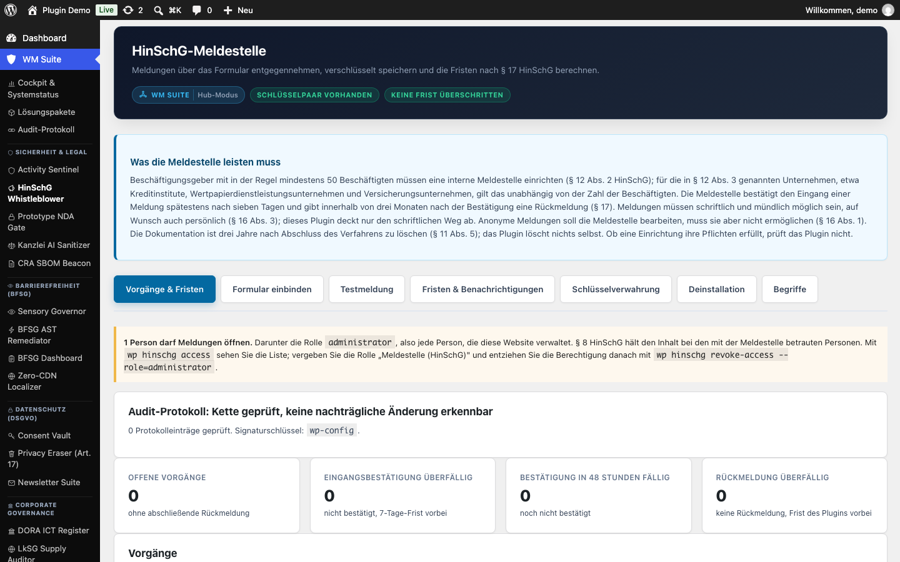
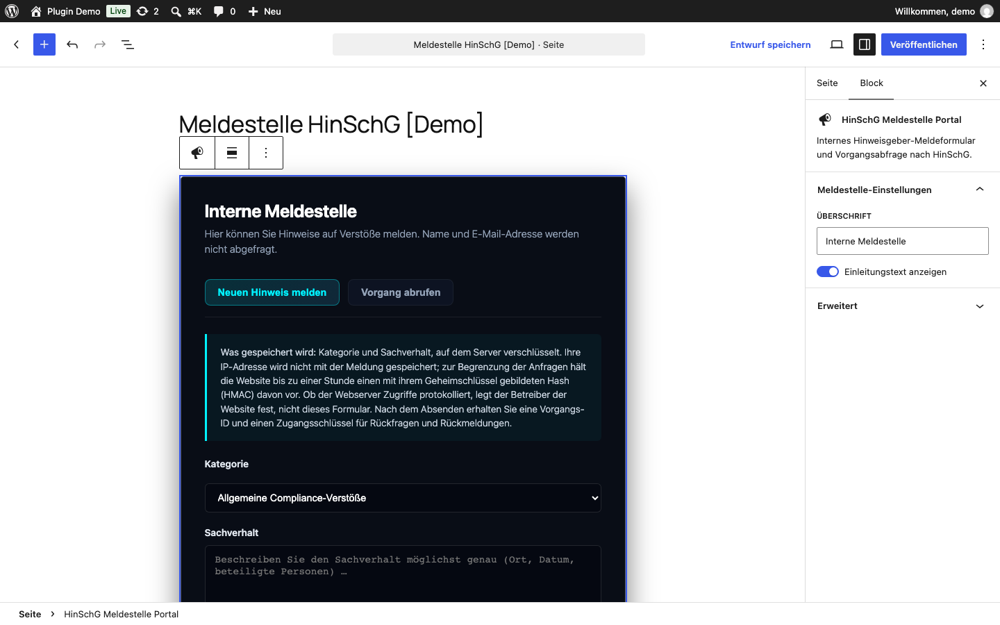
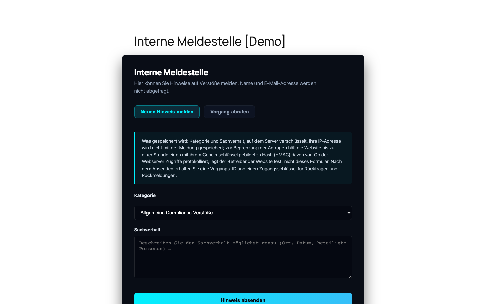

# WM HinSchG Whistleblower Desk (Documentación en Español)

<p align="center">
  <a href="README.md"></a>
  <a href="README.de.md"></a>
  <a href="README.es.md"></a>
</p>

Plugin para WordPress para un canal interno de denuncias conforme a la ley alemana Hinweisgeberschutzgesetz (HinSchG): formulario de comunicación, cifrado en servidor de denuncias y mensajes de seguimiento, plazos del § 17 HinSchG y registro de auditoría con clave HMAC.

Requiere WordPress 6.4 y PHP 8.2. Versión 1.4.1 (cabecera del plugin). **Página del Plugin:** [https://arnoldwender.com/es/plugins-wordpress/wm-hinschg-whistleblower/](https://arnoldwender.com/es/plugins-wordpress/wm-hinschg-whistleblower/)

Los banners promocionales y maquetas anteriores se archivaron fuera del repositorio el 2026-11-20 (versión 1.4.0).

> **Página del plugin:** [https://arnoldwender.com/es/plugins-wordpress/wm-hinschg-whistleblower/](https://arnoldwender.com/es/plugins-wordpress/wm-hinschg-whistleblower/)  
> **Desarrollado con un agentic workflow:** creado con agentes de programación de IA. Revísalo y pruébalo como cualquier código de terceros antes de usarlo en producción.  
> **Soporte y responsabilidad:** Cero soporte (Zero Support) — errores reproducibles únicamente en [GitHub Issues](https://github.com/arnoldwender/wm-wp-hinschg-whistleblower/issues) · sin soporte privado · TAL CUAL («AS IS») / sin responsabilidad ([SUPPORT.md](SUPPORT.md))

## Capturas en vivo

!Banner de WM HinSchG Whistleblower Desk

| Panel de casos | Editor Gutenberg | Formulario Público |
|---|---|---|
|  |  |  |

## Qué hace el plugin

- **Formulario y bloque Gutenberg:** `[wm_whistleblower_portal]` (equivalente: `[wm_hinschg_portal]`) y el bloque `wm/hinschg-portal` (`blocks/portal/block.json`, script `wm-hinschg-blocks-editor` con `InspectorControls` y `ServerSideRender`) renderizan el formulario de denuncia y consulta de estado con categoría y descripción.
- **Block Bindings y GenerateBlocks 2.x:** Registra la fuente Block Bindings `wm-hinschg/status` (WP 6.5+) y la etiqueta dinámica `{{wm_hinschg_status}}` para indicadores no confidenciales (`channel_label`, `ack_days`, `feedback_months`).
- **Identificador de caso y token de acceso:** Tras enviar una denuncia se muestran una sola vez el ID de caso y un token de 64 caracteres; la base de datos guarda únicamente su HMAC-SHA256 con la sal de autenticación de WordPress.
- **Cifrado en reposo:** Denuncia y mensajes se cifran en el servidor con AES-256-GCM bajo una clave efímera sellada con la clave pública RSA-4096 generada en la activación (o en el navegador en modo `offline-custody` mediante WebCrypto).
- **Plazos:** Acuse de recibo = recepción + 7 días; respuesta = recepción + 3 meses (§ 17 Abs. 2 HinSchG).
- **Panel de casos en wp-admin** (menú «Meldestelle (HinSchG)»): últimos 50 casos con estado y plazos, contadores de vencimientos, instrucciones de inserción, denuncia de prueba, reglas de plazos, glosario y widget de escritorio; si no hay casos reales ofrece tres casos demo (`token_demo_1` a `token_demo_3`).
- **Control de plazos y hooks:** Un cron horario cuenta plazos vencidos y dispara `wm_hinschg_sla_breach_detected`; al arrancar dispara `wm_hinschg_ready`. Límites y configuración son filtrables vía `wm_hinschg_rest_rate_limit` y `wm_hinschg_portal_config`. El plugin no envía correos electrónicos.
- **Gestión y lectura de casos:** La vista de caso descifra la denuncia y el hilo completo (o descifra localmente en navegador en `offline-custody`), incluye el panel **Fallbearbeitung nach § 17 HinSchG** para confirmar recepción (`POST /wm-hinschg/v1/admin/ack`) y responder (`POST /wm-hinschg/v1/admin/reply`), y `GET /wm-hinschg/v1/admin/case` exige `wm_hinschg_read_cases`. Cada apertura registra `CASE_OPENED_BY_COMPLIANCE_OFFICER` en la cadena de auditoría. Las respuestas de la Meldestelle adjuntan `reporter_box` (`sodium_crypto_secretbox`), mientras los mensajes del informante permanecen estrictamente cifrados con RSA-OAEP.
- **Clave de recuperación dual y Multisite:** La pestaña *Schlüsselverwahrung* admite una clave pública RSA de respaldo (`wm_hinschg_recovery_public_key`) para una segunda persona responsable u ombudspersona (§ 8 Abs. 1, § 15 HinSchG), y `wp_initialize_site` inicializa tablas, roles, cron y claves en nuevos sitios Multisite al activarse en red.
- **Control de acceso por capacidad:** El plugin define `wm_hinschg_read_cases` y el rol `Meldestelle (HinSchG)`. El administrador recibe la capacidad al instalar/actualizar; `wp hinschg access`, `wp hinschg grant-access` y `wp hinschg revoke-access` la gestionan por CLI (impide revocar el último acceso).
- **Custodia de clave privada sin texto plano en nuevas activaciones:** `WM_HINSCHG_PRIVATE_KEY` mantiene la clave fuera de la base de datos; `WM_HINSCHG_MASTER_KEY` sella la clave privada RSA-4096 en `wp_options` con `sodium_crypto_secretbox` y migra claves heredadas en texto plano; `WM_HINSCHG_KEY_PASSPHRASE` cifra con frase de paso OpenSSL. Las activaciones nuevas nunca escriben una clave PEM en texto plano en `wp_options`.
- **Registro de auditoría:** Cada evento se encadena con HMAC sobre su predecesor (`wp hinschg audit` verifica la cadena). Ofrece evidencia de manipulación, no inmutabilidad física.
- **API REST** en `wm-hinschg/v1`: `report/submit`, `report/status`, `report/chat` (portal anónimo con límite de tasa HMAC sin guardar IP), `admin/cases`, `admin/case`, `admin/ack`, `admin/reply` (`wm_hinschg_read_cases`).
- **WP-CLI:** `wp hinschg list`, `wp hinschg sla-check`, `wp hinschg audit`, `wp hinschg key-status`, `wp hinschg protect-key`, `wp hinschg access`, `wp hinschg grant-access`, `wp hinschg revoke-access`.
- **Traducciones:** Catálogos `.pot`, `.po`/`.mo` y JED `.json` en 28 locales.
- **WM Suite Hub:** Salud (`NEEDS_CONFIG`, `ERROR`, `DEGRADED`, `HEALTHY`), telemetría y acciones `self_test`, `audit_chain`, `sla_check`.
- **Desinstalación:** Conserva por defecto registros de 3 años (§ 11 HinSchG: `wm_whistle_reports`, `wm_whistle_messages`, `wm_whistle_audit_log`), par de claves, punta de cadena y rol salvo activación explícita de `wm_hinschg_delete_data_on_uninstall`.

Todos los scripts y estilos se entregan en local; el plugin no realiza peticiones salientes.

## Qué no incluye

- **Solo canal escrito:** El § 16 Abs. 3 HinSchG exige además canales orales y reunión presencial bajo solicitud.
- **Sin borrado automático:** El § 11 Abs. 5 HinSchG exige eliminar documentación a los tres años de concluir el procedimiento; el plugin no elimina registros automáticamente.
- **Sin evaluación jurídica:** No determina si una organización está obligada a mantener un canal (§ 12 HinSchG) ni evalúa cumplimiento legal. Véase [docs/LEGAL-COMPLIANCE.md](docs/LEGAL-COMPLIANCE.md).

## Inicio rápido

```bash
wp plugin activate wm-hinschg-whistleblower
wp hinschg sla-check
wp hinschg audit
```

Inserta el bloque `HinSchG Meldestelle Portal` (`wm/hinschg-portal`) o `[wm_whistleblower_portal]` en una página accesible para la plantilla.

## Pruebas

```bash
php tests/test-suite.php
bash tests/run-mutations.sh
php tests/test-pot-freshness.php
cd tests && ../vendor/bin/phpunit --configuration phpunit.xml.dist
wp eval-file tests/wp-runtime-desk.php --user=1
```

## Limitaciones conocidas

- **Los administradores pueden abrir casos hasta retirarles la capacidad:** `wm_hinschg_read_cases` se concede al rol administrador al instalar; la separación prevista en § 8 HinSchG se realiza con `wp hinschg revoke-access --role=administrator` tras asignar una persona responsable.
- **Sin pantalla propia para asignar roles:** La gestión de capacidades corresponde a WordPress o a un plugin de roles.
- **Claves heredadas en texto plano anteriores a v1.2.2:** Instalaciones anteriores a v1.2.2 sin `WM_HINSCHG_MASTER_KEY` ni `WM_HINSCHG_KEY_PASSPHRASE` en `wp-config.php` conservan el PEM en `wp_options` hasta configurar `WM_HINSCHG_MASTER_KEY` o ejecutar `wp hinschg protect-key`.
- **Cambio de sales en `wp-config.php`:** Cambiar las claves/sales de WordPress invalida los tokens de acceso y hace fallar la verificación de auditoría en la entrada #1.
- **Proxies inversos:** El limitador usa un HMAC rotado cada hora de `REMOTE_ADDR`.
- **Plantillas de estado en navegador:** El PHP del servidor y el editor de bloques usan los 28 catálogos gettext/JED; los resultados dinámicos en `assets/js/portal-crypto.js` usan etiquetas enviadas por `wm_hinschg_portal_config` y encabezados de vista de estado en alemán.

## Documentación

- [README.md](README.md) (referencia en inglés)
- [docs/ARCHITECTURE.md](docs/ARCHITECTURE.md)
- [docs/DEVELOPER-GUIDE.md](docs/DEVELOPER-GUIDE.md)
- [docs/LEGAL-COMPLIANCE.md](docs/LEGAL-COMPLIANCE.md)
- [CHANGELOG.md](CHANGELOG.md)

## Licencia

Distribuido bajo **GNU General Public License v2 or later** (`GPL-2.0-or-later`). Véase [LICENSE](LICENSE).
