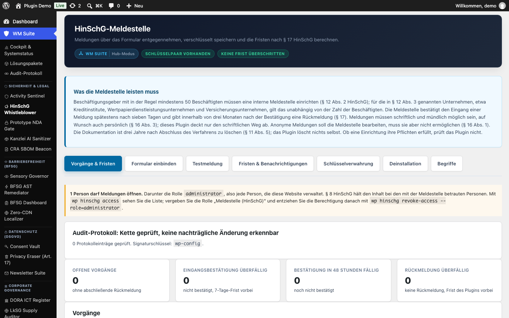
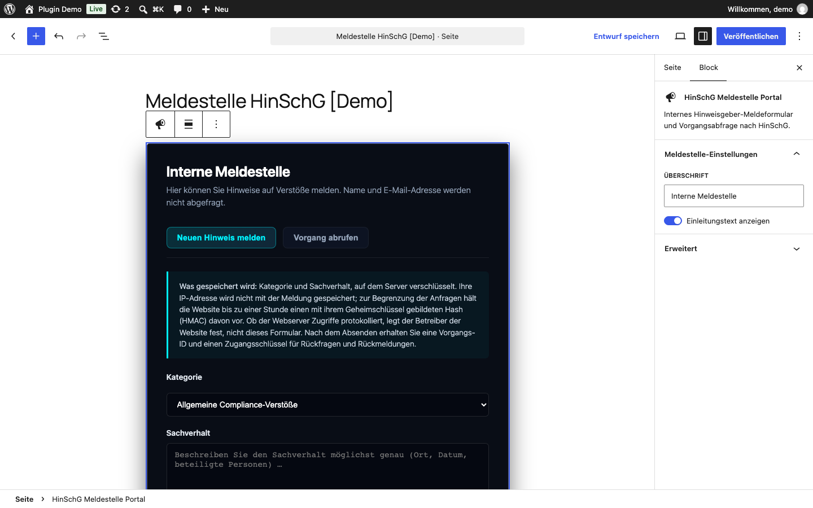
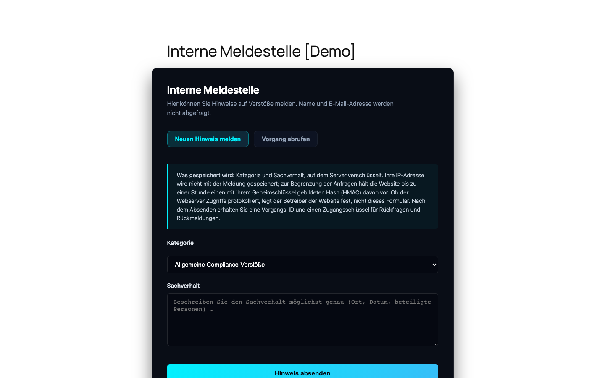

# WM HinSchG Whistleblower Desk

<p align="center">
  <a href="README.md"></a>
  <a href="README.de.md"></a>
  <a href="README.es.md"></a>
</p>

WordPress plugin for an internal whistleblowing channel under the German Hinweisgeberschutzgesetz (HinSchG): a report form, server-side encryption of reports and follow-up messages, the § 17 deadlines, and a keyed audit log.

Requires WordPress 6.4 and PHP 8.2. Version 1.4.1 (plugin header). **Plugin Page:** [https://arnoldwender.com/wordpress-plugins/wm-hinschg-whistleblower/](https://arnoldwender.com/wordpress-plugins/wm-hinschg-whistleblower/)

Superseded promotional banners and early UI mockups were archived outside the repository on 2026-11-20 (release 1.4.0).

> **Plugin page:** [https://arnoldwender.com/wordpress-plugins/wm-hinschg-whistleblower/](https://arnoldwender.com/wordpress-plugins/wm-hinschg-whistleblower/)  
> **Built with an agentic workflow:** developed with AI coding agents. Review and test it like any third-party code before you use it in production.  
> **Support & Liability:** Zero support — reproducible bugs on [GitHub Issues](https://github.com/arnoldwender/wm-wp-hinschg-whistleblower/issues) only · no private support · AS IS / no liability ([SUPPORT.md](SUPPORT.md))

## Showcase

!WM HinSchG Whistleblower Desk banner

| Case Desk | Gutenberg Block Editor | Public Report Form |
|---|---|---|
|  |  |  |

## What the plugin does

- **Report form & Gutenberg block.** `[wm_whistleblower_portal]` (same: `[wm_hinschg_portal]`) and the Gutenberg block `wm/hinschg-portal` (`blocks/portal/block.json`, editor script `wm-hinschg-blocks-editor` with `InspectorControls` and `ServerSideRender`) render a reporting and case-lookup form with category and description.
- **Block Bindings & GenerateBlocks 2.x.** Registers the WordPress 6.5+ Block Bindings source `wm-hinschg/status` and the GenerateBlocks 2.x dynamic tag `{{wm_hinschg_status}}` for non-confidential channel status labels (`channel_label`, `ack_days`, `feedback_months`).
- **Case id and access token.** After submitting, the person gets a case id and a 64-character access token, shown once. With both they can check the status and exchange messages with the Meldestelle in the same form. The database stores only an HMAC-SHA256 of the token, keyed with the WordPress auth salt.
- **Encryption at rest.** Report and messages are encrypted on the server with AES-256-GCM under a fresh key; that key is sealed with an RSA-4096 public key generated on activation. The browser sends plain JSON over the site's HTTPS connection.
- **Deadlines.** Acknowledgment deadline = receipt + 7 days; feedback deadline = receipt + 3 months. § 17 Abs. 2 counts three months from the acknowledgment (or three months and seven days from receipt), so the plugin's feedback deadline is never later than the statutory one.
- **Desk in wp-admin** (menu "Meldestelle (HinSchG)"): the last 50 cases with status and deadlines, counters for overdue and upcoming deadlines, how to embed the form, a test report, the deadline rules, a glossary, and a dashboard widget. With no cases it offers three demo cases (tokens `token_demo_1` to `token_demo_3`).
- **Deadline check & hooks.** An hourly WP-Cron event counts passed deadlines and fires `wm_hinschg_sla_breach_detected` when one passed. Boot fires `wm_hinschg_ready`. Public portal rate limits and frontend configuration are filterable via `wm_hinschg_rest_rate_limit` and `wm_hinschg_portal_config`. The plugin sends no e-mail; hook your own notification to `wm_hinschg_sla_breach_detected`.
- **Reading and handling a case.** The desk links every row to its case view, which decrypts the report and the whole message thread (or renders local browser decryption in `offline-custody` mode) and includes the **Fallbearbeitung nach § 17 HinSchG** panel to confirm receipt (`POST /wm-hinschg/v1/admin/ack`) and send follow-up or final feedback replies (`POST /wm-hinschg/v1/admin/reply`); `GET /wm-hinschg/v1/admin/case` does the same for a caller holding `wm_hinschg_read_cases`. Every open appends `CASE_OPENED_BY_COMPLIANCE_OFFICER` to the audit chain with the user id — § 8 HinSchG makes the content confidential inside the organisation too, so who read what and when is part of what the log answers. Compliance officer replies attach a symmetric `reporter_box` (`sodium_crypto_secretbox`) so the token holder can read them in `offline-custody` mode, while whistleblower messages stay strictly RSA-OAEP Zero-Knowledge.
- **Dual-envelope recovery key & Multisite.** The *Schlüsselverwahrung* tab supports an optional secondary RSA public key (`wm_hinschg_recovery_public_key`) for a 2nd Meldestelle officer or Ombudsperson (§ 8 Abs. 1, § 15 HinSchG), and `wp_initialize_site` initializes tables, roles, cron, and key setup on new multisite sites when network-activated.
- **Who may read one is a capability, and the install decides who holds it.** The plugin declares `wm_hinschg_read_cases` and brings the role `Meldestelle (HinSchG)`; the desk, the dashboard widget and the four `admin/*` routes check that capability and nothing else. It does not manage who holds it — that is what WordPress roles and a role manager are for, and an access screen here would put the same decision in two places. The administrator role receives the capability on install and on update, so no existing install loses its own desk; taking it away from administrators afterwards is the point, and `wp hinschg access`, `grant-access` and `revoke-access` do it from the command line. Revoking the last access is refused: the reports are encrypted, this plugin is the only way in, and the § 17 clock keeps running either way.
- **Where the private key lives is a choice, and new activations never write a plaintext PEM to `wp_options`.** `WM_HINSCHG_PRIVATE_KEY` in `wp-config.php` keeps the key out of the database entirely; `WM_HINSCHG_MASTER_KEY` seals the RSA-4096 private key in `wp_options` with `sodium_crypto_secretbox` (XSalsa20-Poly1305 via HKDF-SHA256) and transparently migrates any legacy plaintext PEM on boot; `WM_HINSCHG_KEY_PASSPHRASE` keeps it encrypted with an OpenSSL passphrase. On a fresh activation without those three constants, `Schema::activate()` seals the generated key via Libsodium derived from `AUTH_KEY`/`SECURE_AUTH_KEY` in `wp-config.php` (or places it into a one-time offline custody transient if no `wp-config.php` secret exists), never persisting a plaintext PEM in `wp_options`. Legacy installs with a pre-existing plaintext PEM still show a warning on the desk and in `wp hinschg key-status` until `WM_HINSCHG_MASTER_KEY` or `wp hinschg protect-key` is configured.
- **Audit log.** Submission, messages, acknowledgment, feedback, case reads and test reports append an entry that carries an HMAC over its predecessor, keyed with `AUTH_KEY` from `wp-config.php`. The chain tip is also stored outside the table. `wp hinschg audit` reports the first entry that does not verify. Tamper-evident rather than write-once: whoever can read `wp-config.php` can re-sign the chain.
- **REST API** under `wm-hinschg/v1`: `report/submit`, `report/status`, `report/chat` (anonymous portal permission callback with hourly-rotated HMAC rate limiting, zero raw IP storage), `admin/cases`, `admin/case`, `admin/ack`, `admin/reply` (`wm_hinschg_read_cases`).
- **WP-CLI:** `wp hinschg list`, `wp hinschg sla-check`, `wp hinschg audit`, `wp hinschg key-status`, `wp hinschg protect-key`, `wp hinschg access`, `wp hinschg grant-access`, `wp hinschg revoke-access`.
- **Translations:** Ships `.pot`, `.po`/`.mo`, and block-editor JED `.json` catalogs across 28 locales (`ar`, `bg_BG`, `cs_CZ`, `da_DK`, `de_DE`, `el`, `en_GB`, `en_US`, `es_ES`, `et`, `fi`, `fi_FI`, `fr_FR`, `ga`, `hr_HR`, `hu_HU`, `it_IT`, `lt_LT`, `lv`, `mt_MT`, `nl_NL`, `pl_PL`, `pt_PT`, `ro_RO`, `sk_SK`, `sl_SI`, `sv_SE`, `tr_TR`).
- **WM Suite Hub:** when the hub is active, the plugin registers as a module with health (NEEDS_CONFIG, ERROR, DEGRADED, HEALTHY), telemetry and the actions `self_test`, `audit_chain`, `sla_check`.
- **Uninstall** cleans rate-limit/test transients, scheduled cron and unused legacy settings, while preserving statutory 3-year HinSchG § 11 records (`wm_whistle_reports`, `wm_whistle_messages`, `wm_whistle_audit_log`), the key pair, the chain tip and the Meldestelle role by default unless the administrator explicitly checks the full-wipe option on the *Deinstallation* tab.

All scripts and styles ship with the plugin; it makes no outbound request.

## What it does not do

- **Written channel only.** § 16 Abs. 3 HinSchG also requires oral reporting and, on request, a meeting in person.
- **No automatic deletion.** § 11 Abs. 5 HinSchG requires deleting the documentation three years after the procedure ends; the plugin deletes nothing on its own.
- **No legal assessment.** The plugin does not check whether an organisation must run a Meldestelle (§ 12) or meets its duties. See [docs/LEGAL-COMPLIANCE.md](docs/LEGAL-COMPLIANCE.md).

## Quick start

```bash
wp plugin activate wm-hinschg-whistleblower
wp hinschg sla-check
wp hinschg audit
```

Insert the `HinSchG Meldestelle Portal` block (`wm/hinschg-portal`) or `[wm_whistleblower_portal]` on a page and link it where employees find it.

## Tests

```bash
php tests/test-suite.php          # standalone: desk, widget, portal, block, hub adapter, REST, uninstall
bash tests/run-mutations.sh       # each entry in tests/mutations.php undoes one fix; the suite must turn red
php tests/test-pot-freshness.php  # every string the code translates has an entry in the .pot (needs wp-cli)
cd tests && ../vendor/bin/phpunit --configuration phpunit.xml.dist
wp eval-file tests/wp-runtime-desk.php --user=1   # inside WordPress, read-only, against the real tables
```

`tests/test-audit-chain-forgery.php` and `tests/test-chat-encryption.php` write to the audit log (the first truncates it). They refuse to run without `WM_HINSCHG_SCRATCH_INSTALL=1`; use them on a scratch install only. CI runs PHPUnit, the standalone suite, the UI gate and the mutation check on PHP 8.2 and 8.3.

## Known issues

- **Administrators can read every report until the install takes the capability off them.** `wm_hinschg_read_cases` is granted to the administrator role on install, so the default behaviour is the old one and nothing breaks on update; separating the Meldestelle from whoever administers the website is work the install has to do (`wp hinschg revoke-access --role=administrator`, after granting the role to the officer). § 8 HinSchG expects that separation, and the desk says on screen when it has not been made.
- **No screen for assigning the capability**, on purpose: WordPress roles and a role manager own that. The WP-CLI commands exist so an install is never stuck without one.
- **Legacy plaintext keys before v1.2.2.** Pre-1.2.2 installs that have neither `WM_HINSCHG_MASTER_KEY` nor `WM_HINSCHG_KEY_PASSPHRASE` in `wp-config.php` still hold a plaintext PEM in `wp_options` until `WM_HINSCHG_MASTER_KEY` is added or `wp hinschg protect-key` is run.
- **Moving the site to other salts breaks access.** Access tokens are keyed with the auth salt and the audit chain with `AUTH_KEY`. On a server with other values every token stops working and the audit check fails at entry #1.
- **Reverse proxies.** The rate limit keys on an hourly-rotated HMAC of `REMOTE_ADDR`. Behind a proxy that does not pass the client address there, all visitors share one budget.
- **Client-side status templates.** Server-rendered PHP markup and the Gutenberg block editor use the 28 gettext/JED catalogs; dynamic result strings inside `assets/js/portal-crypto.js` use category/status labels passed via `wm_hinschg_portal_config` and German status-view headings.

## Documentation

- [docs/ARCHITECTURE.md](docs/ARCHITECTURE.md): classes, data, encryption, audit chain
- [docs/DEVELOPER-GUIDE.md](docs/DEVELOPER-GUIDE.md): WP-CLI, REST, hooks, blocks, tests
- [docs/LEGAL-COMPLIANCE.md](docs/LEGAL-COMPLIANCE.md): what the plugin covers of the HinSchG, with sources
- [CHANGELOG.md](CHANGELOG.md)

## License

Licensed under the **GPLv2 or later** (`GPL-2.0-or-later` — GNU General Public License v2 or later). See [LICENSE](LICENSE) and <https://www.gnu.org/licenses/gpl-2.0.html>.
